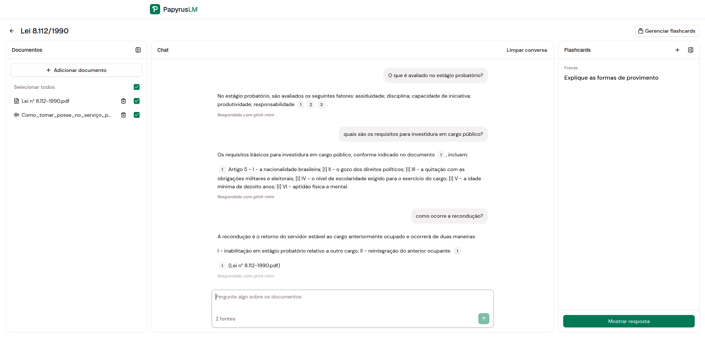

<div align="center">


# PapyrusLM

**An offline study assistant powered by local LLMs.**

Upload your PDFs, documents and audio recordings, chat with them and review what you learned with flashcards — all running on your own computer.

</div>



## Features

- **Notebooks** — organize your study material by subject, with tags for quick filtering.
- **Multi-format ingestion** — PDF, Word, Markdown, plain text and audio files.
- **OCR for scanned PDFs** — pages without a text layer are read with Tesseract.
- **Audio transcription** — lectures and recordings are transcribed locally with Whisper.
- **Chat with your sources** — answers grounded in your documents (RAG), streamed in real time, with inline citations you can hover to preview or click to jump to the exact excerpt.
- **Source selection** — choose which documents the assistant should consult for each conversation.
- **Spaced-repetition flashcards** — create flashcards per notebook and review them.
- **Background processing** — a dedicated worker parses, chunks and embeds documents with retries, so the UI never blocks.
- **100% offline** — the LLM, embeddings, vector search and database all run locally. Your files never leave your computer.

## Tech stack

| Layer | Technologies |
|---|---|
| **Backend** | Python 3.14, FastAPI, SQLAlchemy 2 (async) + aiosqlite, Alembic, Dishka (DI) |
| **AI / RAG** | Ollama, LangChain / LangGraph, sqlite-vec (vector search), faster-whisper (transcription) |
| **Document parsing** | LiteParse + Tesseract OCR, python-docx |
| **Frontend** | React 19, TypeScript, Vite, TanStack Router & Query, Tailwind CSS v4, shadcn/ui + Base UI, Streamdown |
| **Tooling** | Docker Compose, uv, pnpm |

## Requirements

- [Docker](https://docs.docker.com/get-docker/) with Docker Compose v2
- [Ollama](https://ollama.com/download) installed on the host
- ~4 GB of VRAM + ~8GB of RAM

## Setting up Ollama

### 1. Pull the models

PapyrusLM uses one chat model and one embedding model:

```bash
ollama pull phi4-mini              # chat
ollama pull qwen3-embedding:0.6b   # embeddings
```

You can use any other Ollama models — just set `CHAT_MODEL` and `EMBEDDING_MODEL` in your `.env` (see [Environment variables](#environment-variables)).

> [!NOTE]
> Switching `EMBEDDING_MODEL` is safe: on startup the app detects that the model changed, rebuilds the vector index and queues every document to be re-embedded automatically. Because of this check, Ollama must be running when the app starts.

### 2. Let the containers reach Ollama (Linux)

By default Ollama only listens on `127.0.0.1`, which is not reachable from inside Docker containers. The containers connect to the host through `host.docker.internal`, so Ollama must listen on all interfaces.

Open an override for the systemd service:

```bash
sudo systemctl edit ollama.service
```

Add the following lines in the editable section:

```ini
[Service]
Environment="OLLAMA_HOST=0.0.0.0"
```

Then reload and restart the service:

```bash
sudo systemctl daemon-reload
sudo systemctl restart ollama
```

Check that it is listening on all interfaces:

```bash
ss -tlnp | grep 11434   # should show 0.0.0.0:11434 or *:11434
```

> [!NOTE]
> This makes Ollama reachable from your local network as well. If your machine is on an untrusted network, restrict port `11434` with your firewall to the Docker subnets (e.g. `172.16.0.0/12`). If you use `ufw`, you may also need to allow traffic from those subnets for the containers to connect.

On **Docker Desktop** (macOS/Windows), `host.docker.internal` already points to the host and this step is not needed.

## Getting started

```bash
git clone https://github.com/guilherme-torres/papyruslm.git
cd papyruslm
cp .env.example .env
docker compose up -d --build
```

Open **http://localhost:8000**.

## Environment variables

Copy `.env.example` to `.env` and adjust as needed.

### Docker Compose

| Variable | Default | Description |
|---|---|---|
| `API_PORT` | `8000` | Host port where the app is exposed |
| `OLLAMA_BASE_URL` | `http://host.docker.internal:11434` | Ollama API URL as seen from the containers |
| `CHAT_MODEL` | `phi4-mini` | Ollama model used for chat |
| `CHAT_CONTEXT_TOKENS` | `4096` | Context window (`num_ctx`) for the chat model |
| `EMBEDDING_MODEL` | `qwen3-embedding:0.6b` | Ollama model used for embeddings |
| `WHISPER_MODEL` | `base` | Whisper model size (`tiny`, `base`, `small`, `medium`, …) |
| `WORKER_REPLICAS` | `1` | Number of worker containers |
